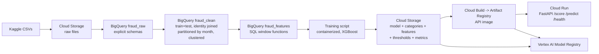

# Fraud Detection & Real-Time Risk Scoring

End-to-end fraud detection platform on the **IEEE-CIS** dataset (1.1M e-commerce transactions): a BigQuery data pipeline, leakage-free model development, and a containerized **FastAPI** scoring service on **Cloud Run** returning a risk score, a decision and **SHAP** explanations in about **10 ms**.

**Live API:** https://fraud-api-503031865362.europe-west1.run.app/docs (interactive documentation)

> Built to production constraints rather than leaderboard conditions: strict time-based validation with a 30-day gap, past-only features, and every design choice measured with ablations against a noise floor.

---

## Results

Validation month (days 153–182), model trained on days 31–108 with early stopping on days 109–122. Fraud rate: 3.5%.

| Metric | Value |
|---|---|
| **PR-AUC** | **0.518** (≈ 15× the 0.035 random baseline) |
| ROC-AUC | 0.888 |
| Top 1% of transactions flagged | **85.8% precision**, 24.5% recall |
| Top 5% of transactions flagged | 40.1% precision, **57.2% recall** |
| PR-AUC, non-W products / W products | 0.715 / 0.192 |

In the validation month (85,430 transactions, 2,994 frauds), reviewing the top 1% means about 850 alerts, of which about 733 are fraud.

**Serving (Cloud Run, 1 vCPU):** in-app latency median **10.1 ms** (p95 ≈ 13 ms) over 20 requests; exact SHAP explanations add about 155 ms and are computed only for flagged transactions.

> Not comparable to the Kaggle leaderboard: top solutions built features over train *and* test combined (future information) and were scored on a different period. Here, every feature is computable at scoring time from the transaction itself.

---

## Architecture



| Layer | Content |
|---|---|
| `fraud_raw` | The 4 source files loaded as-is, with explicit JSON schemas (`sql/schemas/`) |
| `fraud_clean.transactions` | Train + test on one timeline, identity left-joined, ID codes cast to INT64. **Partitioned by month, clustered by `ProductCD, card1, addr1`** |
| `fraud_features.*` | Behavioral uid features, transaction features, and the final `model_table_v1` with a `fold` column |

Measured with BigQuery dry runs: selecting one column reads 8.8 MB from a multi-GB table (columnar storage), and filtering one month reads about 8% of the rows (partition pruning skips about 92%).

---

## Methodology and key decisions

### Exploratory analysis (`notebooks/`, `docs/eda_decisions.md`)
- **Two data regimes:** product W (75% of traffic, 2.0% fraud) never has identity data or a recipient email; product C (11.6%) has 11.7% fraud and about 39% of all fraud.
- **Confounding checked:** "has identity data = 3.7× riskier" turned out to be mostly a product effect.
- **Redundancy:** the 339 masked V columns form 15 missing-value blocks; reduced to 138 by correlation within each block.
- **Pseudo customer ID:** `card1 + addr1 + (day − D1)` validated. Fraud groups are 39% pure under this key, against 3.6% with `card1` alone and about 2% expected by chance.
- **Drift:** adversarial validation between train and test reaches AUC 0.907. Browser version numbers were artificial drift (fixed with a browser family). Normalizing the D columns made drift *worse* (AUC 1.000, absolute dates), so that idea was rejected.

### Validation scheme (mimics deployment)
| Fold | Days | Use |
|---|---|---|
| warmup | 1–30 | History only (cold-start effect at the start of the data) |
| train | 31–122 | Training (early stopping on 109–122) |
| gap | 123–152 | Skipped: mimics the 30-day delay before deployment |
| valid | 153–182 | Evaluation, touched once |
| test | 213–395 | Unlabeled; used for drift analysis and alert thresholds |

### Feature engineering and ablations
Behavioral features were built in **BigQuery SQL with past-only window functions** (transactions so far, time since previous, 24h/7-day velocity, amount vs the customer's history) and audited by hand on individual customers.

Ablations (PR-AUC on the validation month):

| Feature set | Seed 42 | Seed 7 |
|---|---|---|
| All 240 features (incl. history-based) | 0.511 | 0.509 |
| Raw columns only | 0.528 | 0.516 |
| **Raw + 6 row-level features (chosen, 226)** | **0.518** | **0.521** |
| Without D columns | 0.504 | |
| Without V columns | 0.424 | |

- Seed noise reaches about **0.012**, so differences smaller than that were treated as inconclusive.
- The history-based features **did not measurably help**. The most consistent explanation is redundancy: Vesta's own V/C/D features were built with real customer identities and full history.
- **Decision:** the row-level set gives the same accuracy within noise, is the most stable across seeds, needs **no history store at serving time**, and keeps readable signals (credit/debit, browser family, amount decimals) for explanations.

### Final model
XGBoost with class weighting (`scale_pos_weight` ≈ 25), trained on all labeled days after warm-up (31–182, 456,201 rows) with 2,000 trees. The tree count is a documented heuristic: early stopping chose 1,465–1,853 trees on the development split, and the final model sees about twice the data.

---

## Scoring API

| Endpoint | Description |
|---|---|
| `GET /health` | Model version, XGBoost version, thresholds |
| `POST /score` | One raw transaction → `risk_score`, `decision`, `top_reasons` (SHAP), `unknown_fields`, `latency_ms`. `?explain=true` forces explanations |
| `POST /predict` | Batch scoring in Vertex AI format: `{"instances": [...]}` → `{"predictions": [...]}` |

Example:
```bash
curl -X POST "https://fraud-api-503031865362.europe-west1.run.app/score" \
  -H "Content-Type: application/json" \
  -d @tests/samples/txn_fraud.json
```

Design points:
- **Decisions by alert budget:** `high_risk` = top 1% of recent traffic (score ≥ 0.989), `review` = top 5% (≥ 0.043), computed on unlabeled test-period traffic. Scores are ranking scores, **not calibrated probabilities**, because of class weighting.
- **Explanations where they're read:** exact TreeSHAP (XGBoost `pred_contribs`) for `review`/`high_risk` only. The approve path (95% of traffic) stays at about 10 ms.
- **Training-serving parity:** `src/serving/check_parity.py` feeds 1,182 real raw transactions through the serving code and compares all 226 model inputs and the predictions with the training pipeline: **identical**. It caught a real skew bug (`has_identity`, a derived training feature absent from raw requests).
- **Fail-fast startup:** the API refuses to start if the runtime XGBoost version differs from the training version.
- **Input hygiene:** fields outside the raw IEEE-CIS schema are reported in `unknown_fields`, so client typos are visible.

---

## Repository structure

```
├── cloudbuild.api.yaml        # Cloud Build config for the API image
├── docker/                    # api.dockerfile, trainer.dockerfile, pinned requirements
├── docs/                      # EDA decisions, GCP notes, model results
├── notebooks/                 # 01_eda, 02_drift
├── sql/
│   ├── schemas/               # explicit BigQuery schemas (raw layer)
│   ├── 01_clean_transactions.sql
│   ├── 02_uid_features.sql
│   ├── 03_txn_features.sql
│   └── 04_model_table.sql     # generated
├── src/
│   ├── data/                  # local loader, BigQuery export
│   ├── gcp/                   # schema generation, model table generation
│   ├── features/              # feature lists v1/v2, V-column selection
│   ├── models/                # training + ablations
│   ├── cloud/                 # containerized training job
│   └── serving/               # FastAPI app, features, parity test, thresholds, benchmark
└── tests/samples/             # example requests
```

## Reproducing

Prerequisites: Python 3.11, Docker, a GCP project with BigQuery, Cloud Storage, Cloud Build, Cloud Run and Vertex AI enabled, and a `.env` file with `GCP_PROJECT_ID` and `GCP_REGION`. The dataset comes from the [IEEE-CIS Fraud Detection](https://www.kaggle.com/c/ieee-fraud-detection) competition and is not redistributed here; place the CSVs in `data/raw/`.

1. **Raw layer:** upload the CSVs to Cloud Storage, `python -m src.gcp.make_schemas`, then `bq load` each table with its schema.
2. **Clean and feature layers:** run `sql/01`, `sql/02`, `sql/03`, then `python -m src.gcp.build_model_table` and `sql/04`.
3. **Train:** `python -m src.cloud.train_job --project <id> --mode validate|final --output gs://<bucket>/models/xgb_v2`
4. **Serve locally:** `python -m src.serving.make_thresholds`, `python -m src.serving.check_parity`, then `uvicorn src.serving.app:app --port 8000`
5. **Deploy:** `gcloud builds submit --config cloudbuild.api.yaml --substitutions=_IMG=<image>`, then `gcloud run deploy`.

---

## Limitations and next steps

- **Product W is the weak spot** (PR-AUC 0.19): it has no identity data. Features targeted at W are the most promising improvement.
- **One validation month:** a rolling backtest over several months would give tighter estimates.
- **No hyperparameter tuning yet:** sensible defaults were used; tuning would likely add a few points.
- **Uncalibrated scores:** fine for ranking and alert budgets; probability calibration would be needed for expected-loss decisions.
- **Training ran locally, not on Vertex AI:** the free-trial quota allows 1 training CPU (Vertex machines need at least 2) and isn't adjustable. The trainer is containerized and pushed to Artifact Registry, ready to run as a Vertex AI custom job once quota allows.
- **Public endpoint without authentication** (demo only). Production would require IAM-based access or an API gateway.
- **Model baked into the image:** simple and versioned, but a new model needs a new image.
- **No CI and no monitoring yet:** a CI pipeline building and testing the Linux image would have caught the file-name case bug found during deployment; production would also need drift and score-distribution monitoring with scheduled retraining (weekly fraud rate varied from 1.8% to 5.0% in the data).
- **Explanations on anonymized data:** SHAP correctly reports which signals drove a score, but many features are masked (V, C, D, id) or are ID codes treated as numbers (`card1`, `addr1`), which limits their meaning for an analyst.

## Lessons learned
- Test every fix: a drift fix that seemed obvious (normalizing D columns) made drift worse.
- Estimate noise before trusting a difference: one seed pair suggested a 0.017 gain that turned out to be mostly luck.
- A parity test is only as good as its inputs: feeding it pre-processed rows hid a real skew bug.
- Windows hides case differences that Linux doesn't: test the actual container, not just the code.

---

**Data:** IEEE-CIS Fraud Detection, provided by Vesta Corporation via Kaggle. Column meanings are largely masked by the data provider.
